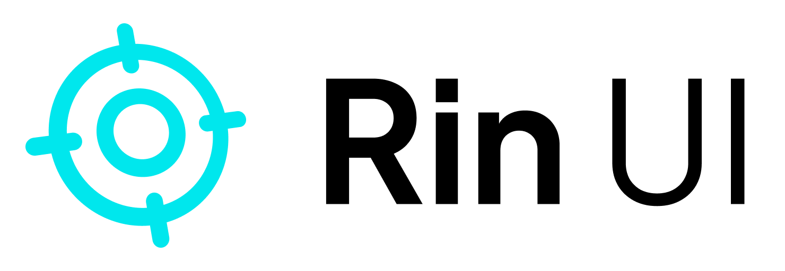
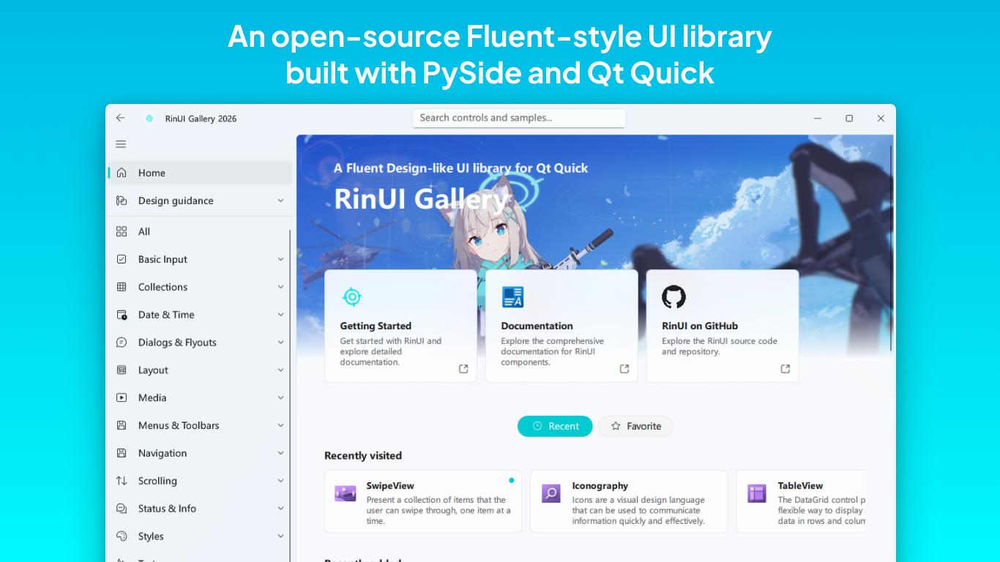
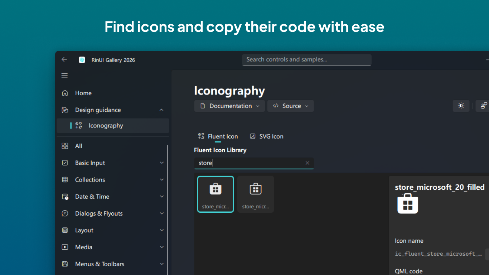
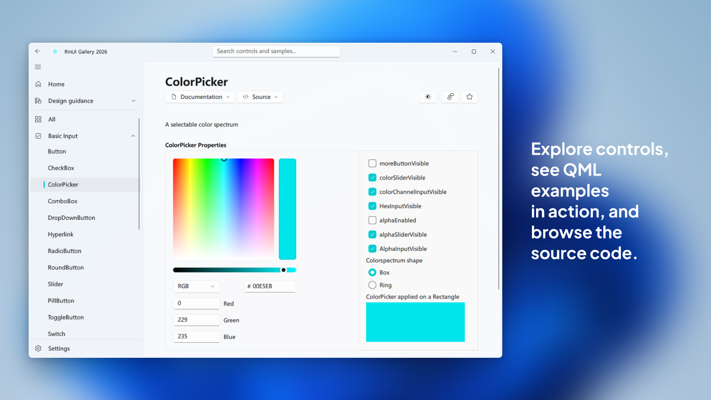
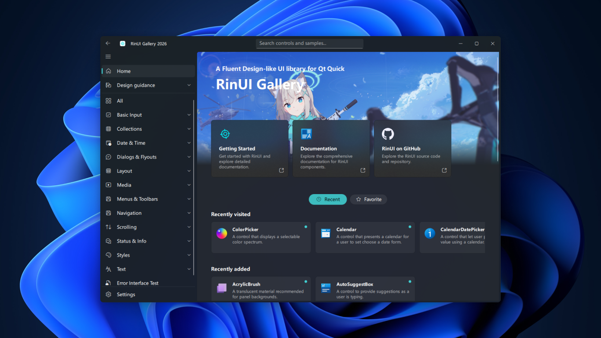
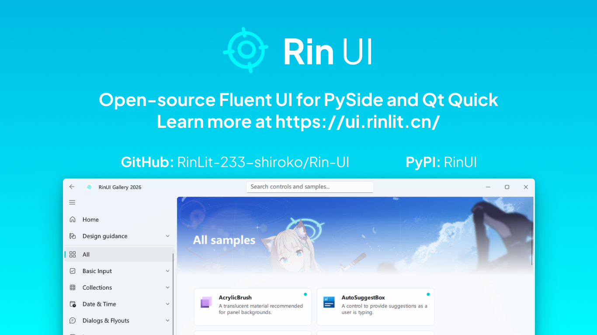

<div align="center">

<h1>
    <a href="https://rinlit.cn">
      <picture>
        <source
          media="(prefers-color-scheme: dark)"
          srcset="docs/img/logo-dark.png">
        
      </picture>
    </a>
</h1>
<p>An open-source Fluent-style UI library <br> built with PySide and Qt Quick</p>

**English** | [中文](./docs/README_zhCN.MD)

</div>

RinUI is a UI library similar to Fluent Design for Qt Quick (QML), RinUI will provide high-quality components and practical functions.
With simple configuration, you can quickly develop elegant UI interfaces in the Fluent style.

Explore RinUI's Fluent-inspired Qt Quick/QML controls through interactive samples, documentation, icons, and source links.

### Screenshots


<details style="text-align: center">
<summary>More screenshots...</summary>





</details>


<p align="center">
<a href="https://apps.microsoft.com/detail/9NJGH90NLXDM?referrer=appbadge&mode=full" target="_blank"  rel="noopener noreferrer">
	<picture>
    <source
      media="(prefers-color-scheme: dark)"
      srcset="https://get.microsoft.com/images/en-us%20light.svg">
    
  </picture>
</a>
</p>

> The image in the banner comes from Pixiv, PID: [125975786](https://www.pixiv.net/artworks/125975786)


> [!NOTE]
> ### RinUI has reached 100 ⭐!
> This milestone came as a pleasant surprise to me. Thank you to everyone who follows, uses, and supports the project.
> 
> I would also like to give special thanks to all contributors.
> Whether through code contributions, issue reports, or suggestions and discussions, your efforts have helped make RinUI better.

### Features
* Elegant Fluent Design controls (WIP)
* Dark and light mode, automatic switching
* Compatible with original QML control names
* i18n Internationalization
* Multi-programming language support (WIP)
* Theme system (WIP)
* Development documentation, [preview](https://ui.rinlit.cn/) now.

## 🪄 Usage

You can install RinUI via pip:
```bash
pip install RinUI
```

Import RinUI in your QML file:
```qmllang
import RinUI
```
Then you can run the QML file in your project.
```python
import sys
from RinUI import *
from PySide6.QtWidgets import QApplication

if __name__ == '__main__':
    app = QApplication(sys.argv)
    your_app = RinUIWindow("/path/to/your/file.qml")
    sys.exit(app.exec_())
```

You also can view the demo in the source code, like this:
```bash
cd examples
python gallery.py
```

You also can move the RinUI folder to anywhere in your project's directory.

> [!NOTE]
> The documentation is still in progress!!
> You can view the source code to learn more about the components and themes at the moment.

Now you can learn more about RinUI components and themes in [the online documentation](https://ui.rinlit.cn/).

## 🙌 Acknowledgements
### Resources
- [PySide6 & Qt Quick](https://www.qt.io/)
- [Fluent Design System](https://fluent2.microsoft.design/)
- [Fluent UI System Icons](https://github.com/microsoft/fluentui-system-icons/)
- [WinUI 3 Gallery](https://github.com/microsoft/WinUI-Gallery)

### Contributors
Contributions are welcome! Please read the [contribution guidelines](./CONTRIBUTING.md) before submitting a pull request.

Thanks to the great people who contributed to this project.
[](https://github.com/RinLit-233-shiroko/Rin-UI/graphs/contributors)

## 📜 License
This project is licensed under the **MIT** License, you can learn more about it in the [license file](./LICENSE).

Copyright © 2025 RinLit

##

This is an experimental project by Rin as a newcomer. Welcome to suggest and contribute to this project. ❤️
