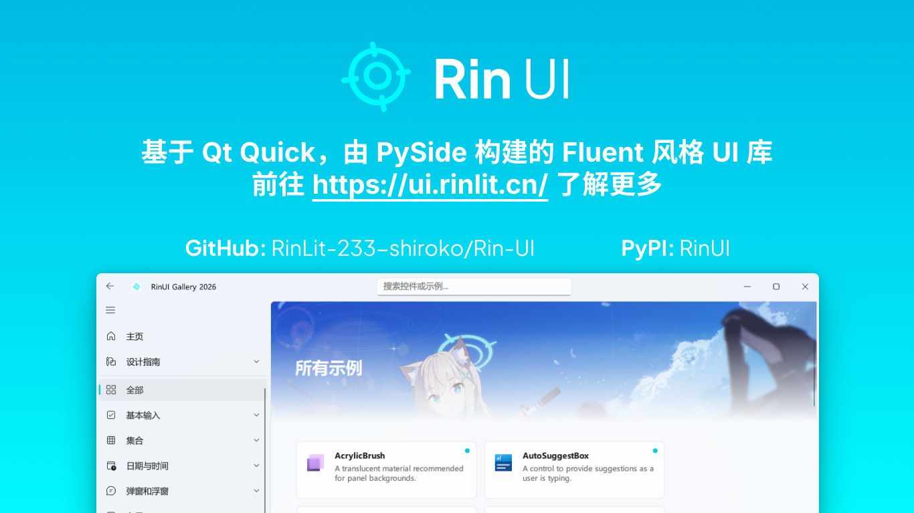
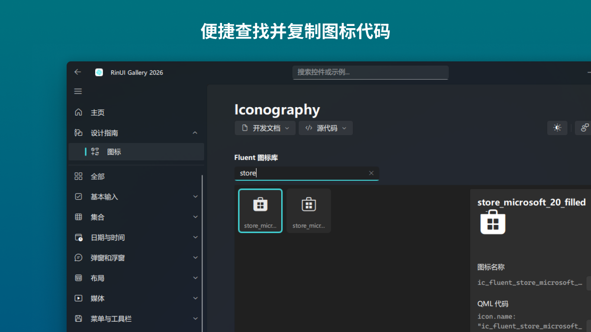
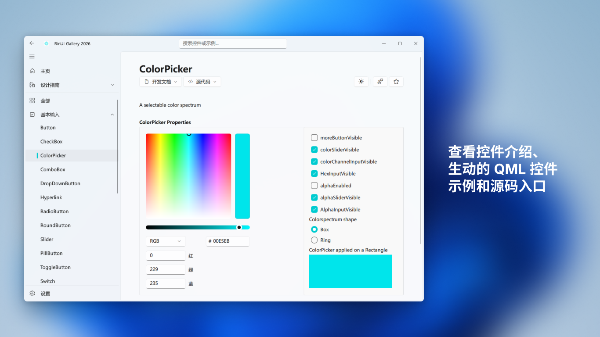
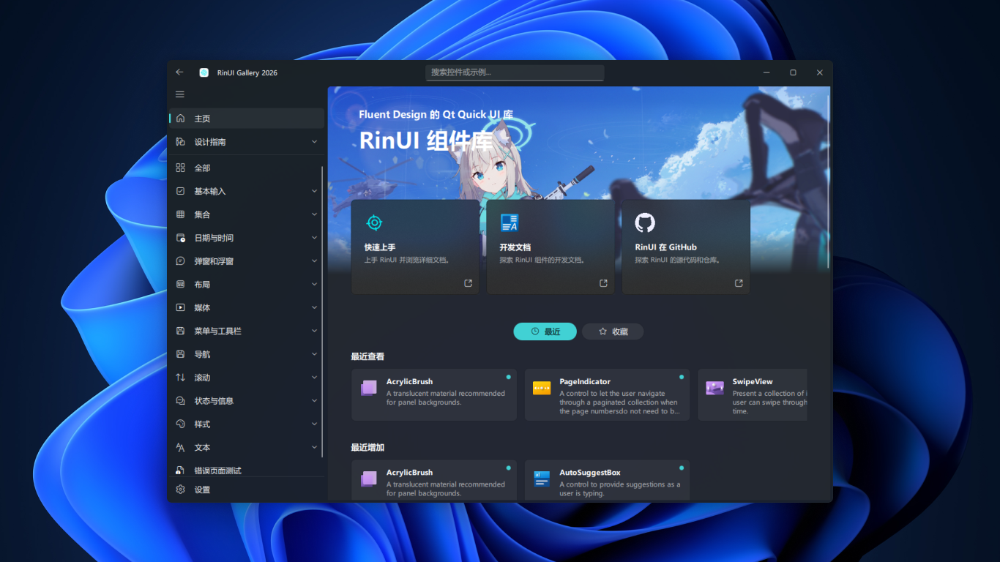

<div align="center">

<a href="https://rinlit.cn">
  <picture>
    <source
      media="(prefers-color-scheme: dark)"
      srcset="docs/img/logo-dark.png">
    
  </picture>
</a>

<h1 hidden>RinUI</h1>
<p>一个类 Fluent Design 的 Qt Quick (QML) UI 库</p>

**中文** | [English](../README.md)

</div>

> [!NOTE]
> ### RinUI 已获得 100 个 ⭐！
> 这个里程碑让我感到惊喜。感谢每一位关注、使用和支持本项目的人。
>
> 同时也要特别感谢所有贡献者。
> 无论是提交代码、报告问题，还是提出建议、参与讨论，你们的努力都让 RinUI 变得更好。

## 📄 介绍

RinUI 是一个类 Fluent Design 的 Qt Quick (QML) UI 库，RinUI 将提供高品质的组件和实用功能。
仅需简单配置，即可快速开发出优雅的 Fluent 风格 UI 界面。

### 特性
* 优雅的 Fluent Design 控件（WIP）
* 深浅色模式以及自动切换
* 兼容原版 QML 控件名
* 国际化支持
* 多编程语言支持（WIP）
* 主题系统（WIP）
* 在线开发文档，[现在可以在此预览](https://ui.rinlit.cn/)（WIP）

### 截图展示


<details style="text-align: center">
<summary>更多截图...</summary>





</details>

> 横幅中的图片来自 Pixiv，PID：[125975786](https://www.pixiv.net/artworks/125975786)

## 🪄 使用方法

你可以通过 pip 安装 RinUI：
```bash
pip install RinUI
```

在你的 QML 文件中导入 RinUI：
```qmllang
import RinUI
```
然后即可在项目中运行 QML 文件：
```python
import sys
from RinUI import *
from PySide6.QtWidgets import QApplication

if __name__ == '__main__':
    app = QApplication(sys.argv)
    your_app = RinUIWindow("/path/to/your/file.qml")
    sys.exit(app.exec_())
```

你也可以在源码中查看示例，如下所示：
```bash
cd examples
python gallery.py
```

你也可以将 RinUI 文件夹移动到你的项目目录中的任意位置。

> [!NOTE]
> 文档仍在编写中！！
> 目前，你可以查看源码来了解组件和主题的更多信息。

现在你可以在[在线开发文档](https://ui.rinlit.cn/)中进一步了解 RinUI 的组件和主题。

## 🙌 致谢
### 资源
- [PySide6 & Qt Quick](https://www.qt.io/)
- [Fluent Design System](https://fluent2.microsoft.design/)
- [Fluent UI System Icons](https://github.com/microsoft/fluentui-system-icons/)
- [WinUI 3 Gallery](https://github.com/microsoft/WinUI-Gallery)

### 贡献者
欢迎贡献！在提交拉取请求之前，请阅读[贡献指南](../CONTRIBUTING.md)。

感谢为本项目做出贡献的优秀开发者们。
[](https://github.com/RinLit-233-shiroko/Rin-UI/graphs/contributors)

## 📜 许可证
本项目采用 **MIT** 许可证，你可以在[许可证文件](../LICENSE)中了解更多信息。

版权所有 © 2025 RinLit

##

这是 Rin 作为新人开发的实验性项目，欢迎提出建议并贡献代码。❤️
